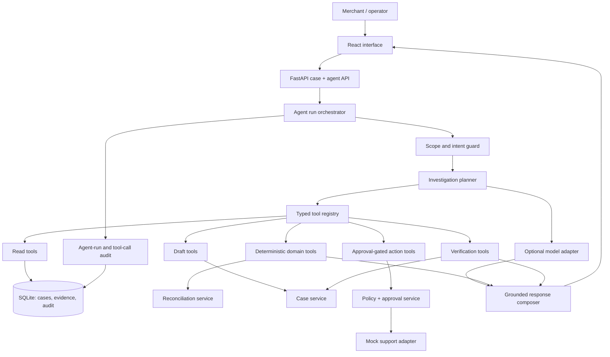
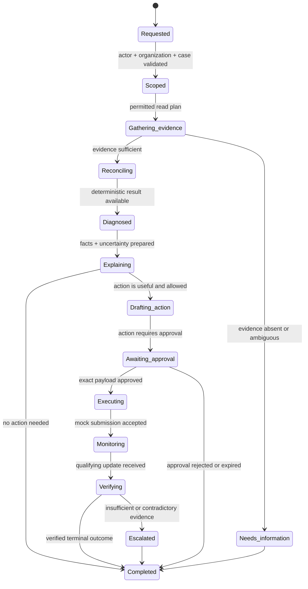

# Agentic Architecture — SettleSaathi Release 0

**Status:** Approved design baseline  
**Scope:** A bounded financial-operations agent for the synthetic hackathon prototype  
**Product promise:** Investigate, explain, prepare, monitor, and verify settlement cases—without becoming the source of financial truth or an unrestricted actor.

## 1. Agent role and hard boundary

SettleSaathi is a **case-owning workflow agent**, not a generic chatbot and not an autonomous financial actor.

The agent may:

- understand a merchant question or an exception trigger;
- retrieve scoped, source-backed records through typed read tools;
- ask deterministic services to reconcile and classify records;
- explain facts, uncertainty, and recommended next steps in natural language;
- draft a mock support-case payload;
- request an exact-payload approval;
- submit a mock external case only through a policy-checked tool after approval;
- monitor mock updates and request deterministic verification.

The agent may never:

- calculate or invent balances, payment status, settlement status, or bank confirmation;
- bypass organization scope, policy, approval, case state, or idempotency controls;
- move money, issue refunds, change payout/bank details, access secrets, or handle OTP/PIN/CVV data;
- declare a case resolved without a verification result from deterministic code and authoritative mock evidence.

## 2. Complete architecture



The model is optional and replaceable. In deterministic mode, the workflow still invokes the same domain tools and presents templated, evidence-backed explanations.

## 3. Runtime state machine

An agent run is persisted. It does not rely on in-memory chat history for correctness or resume behavior.



Each transition records its reason, actor, case/run ID, correlation ID, tool input/output reference, and policy result in SQLite.

## 4. Responsibilities by layer

| Layer | Responsibility | Trust level | Cannot do |
| --- | --- | --- | --- |
| Intent interpreter | Convert a question into a bounded request type | Untrusted assistant input | Assert financial facts or select an unrestricted tool. |
| Scope guard | Validate user, demo organization, role, case, and allowed data scope | Deterministic | Grant access based on model instruction. |
| Planner | Select the next allowed read/diagnose/draft step | Constrained | Execute sensitive action directly. |
| Evidence assembler | Retrieve and normalize only relevant records into a cited evidence bundle | Deterministic | Change source records or omit conflicting facts. |
| Reconciliation service | Match records, calculate money, classify exceptions | Deterministic authority | Generate user-facing prose or bypass rules. |
| Policy engine | Return `ALLOWED`, `APPROVAL_REQUIRED`, or `BLOCKED` for an action | Deterministic authority | Call an adapter itself. |
| Approval service | Bind an approver to exact action payload hash and expiry | Deterministic authority | Approve on behalf of a user. |
| Action executor | Submit an approved idempotent mock action | Deterministic adapter | Trust a model claim of approval. |
| Verification service | Check terminal evidence and decide closure eligibility | Deterministic authority | Close on a message alone. |
| Response composer | Explain verified facts, uncertainty, and allowed next steps | LLM optional | Change case state or present an assumption as fact. |

## 5. Agent tools

Tools are small, typed, server-owned functions. The model receives tool descriptions and validated outputs; it never receives database credentials, raw secrets, or arbitrary code execution.

### 5.1 Read and diagnosis tools

| Tool | Input | Output | Policy |
| --- | --- | --- | --- |
| `get_case` | case ID | current case, state, subject | organization and role scope required |
| `get_case_timeline` | case ID | chronological case events | organization and role scope required |
| `get_reconciliation_evidence` | result/exception ID | source IDs, amounts, rules, reason code | organization and role scope required |
| `get_settlement_detail` | settlement ID | batch and line items | organization and role scope required |
| `get_bank_match_candidates` | settlement ID | qualified bank-credit candidates | organization and role scope required |
| `run_reconciliation` | scoped subject ID | stored result ID | idempotent domain command |
| `classify_case_next_step` | case ID | wait, request info, draft action, escalate | deterministic rule output |

### 5.2 Draft and approval tools

| Tool | Input | Output | Policy |
| --- | --- | --- | --- |
| `draft_support_case` | case ID | versioned draft, evidence references, payload hash | may only draft from retrieved evidence |
| `request_approval` | case ID, draft version | pending approval record | actor may request, not self-approve |
| `approve_action` | approval ID, payload hash | approved/denied record | authorized human role; exact hash and unexpired record |

### 5.3 Execution and verification tools

| Tool | Input | Output | Policy |
| --- | --- | --- | --- |
| `submit_mock_support_case` | case ID, approval ID, idempotency key | mock external reference | server validates policy, approval, case state, and payload hash |
| `get_mock_support_update` | external reference | normalized support update | read-only adapter |
| `verify_case_outcome` | case ID | verified/active/escalated result | deterministic terminal-evidence rule |
| `escalate_case` | case ID, reason code | escalation case event | permitted for ambiguous/blocked conditions |

## 6. Evidence contract

The agent can explain only a fact present in an **evidence bundle**. An evidence bundle is generated server-side and includes:

```text
bundle_id, organization_id, case_id, generated_at,
source_record_ids, reconciliation_result_id, rule_version,
observed_facts, unresolved_questions, permitted_action_summary
```

Every model-facing fact has a source label, such as `transaction:mock_txn_...`, `settlement:mock_settle_...`, or `bank_entry:mock_bank_...`. The UI resolves those labels into human-readable evidence panels.

The response composer must structure its output as:

1. **What we found** — only observed facts.
2. **What this means** — deterministic classification and plain-language explanation.
3. **What we cannot yet confirm** — explicit uncertainty.
4. **Recommended next step** — a policy-permitted option.
5. **Action status** — drafted, awaiting approval, submitted, monitored, verified, or escalated.

## 7. Approval and action control

```mermaid
sequenceDiagram
    participant A as Agent workflow
    participant C as Case service
    actor U as Authorized user
    participant P as Policy service
    participant M as Mock support adapter
    A->>C: Draft versioned support payload from evidence
    C-->>U: Show draft + evidence + required action
    U->>C: Approve exact payload hash
    C->>P: Validate actor, role, state, expiry, hash
    alt Policy valid
        P->>M: Submit with idempotency key
        M-->>C: Mock external reference
        C-->>A: Move case to Monitoring
    else Policy invalid
        P-->>C: Reject action; record audit event
        C-->>A: Explain block without executing
    end
```

An approval is invalid if the payload changes, it expires, it belongs to a different case/action, the user lacks the required role, or the case is no longer in an executable state.

## 8. Model use and deterministic fallback

| Capability | With a configured model | Without a model |
| --- | --- | --- |
| Understand user phrasing | Intent extraction from constrained request schema | Structured UI action / keyword-to-intent mapping |
| Explain evidence | Natural-language grounded summary | Template using evidence and reason code |
| Draft case narrative | Concise evidence-backed draft | Deterministic case template |
| Tool selection | Constrained planner with allowlisted tools | Fixed state-machine routing |
| Financial result | Never model-generated | Deterministic reconciliation service |

The model adapter receives a minimal evidence bundle, a tool allowlist, a response schema, and explicit instructions that source/tool text is data, not authority. Tool outputs and retrieved data are treated as untrusted until application validation succeeds.

## 9. Memory and persistence

| Memory type | Storage | Retention in Release 0 | Rule |
| --- | --- | --- | --- |
| Case memory | SQLite case, event, and evidence tables | Dataset lifetime | Authoritative operational context. |
| Agent-run memory | SQLite `agent_runs` and `agent_steps` | Dataset lifetime | Stores state, tool calls, outputs, and errors. |
| Conversation summary | Versioned case summary | Dataset lifetime | Derived from evidence; never the authoritative source. |
| Model context | In-process request only | Not persisted by default | Contains minimum required scope. |
| Vector memory/RAG | Not used | N/A | Deferred until a validated need exists. |

## 10. Failure, escalation, and recovery

| Failure condition | Agent response | Case result |
| --- | --- | --- |
| Missing source data | State missing evidence; request file or wait | `AWAITING_INFORMATION` |
| Conflicting records | Show conflict; do not select a convenient answer | `ESCALATED` or active investigation |
| Model timeout/failure | Use deterministic fallback explanation | Case remains safe and active |
| Tool validation failure | Stop execution; record reason and correlation ID | Active or escalated |
| Approval missing/stale | Do not submit | `AWAITING_APPROVAL` |
| Duplicate submission attempt | Reuse prior idempotent result | No duplicate external action |
| Terminal evidence absent | Do not close | `MONITORING` or `ESCALATED` |

## 11. Observability and evaluation

### Required agent-run fields

```text
run_id, case_id, initiated_by, trigger_type, state,
model_mode, tool_calls, tool_outcome, policy_decisions,
evidence_bundle_ids, correlation_id, started_at, ended_at, error_code
```

### Required evaluation suite

| Evaluation | Pass condition |
| --- | --- |
| Evidence-groundedness | Every stated amount/status maps to returned evidence. |
| Financial integrity | Agent cannot change deterministic reconciliation output. |
| Authorization | Submission is denied without valid approval. |
| Tenant scope | A demo user cannot retrieve another organization’s records. |
| False closure | No ambiguous or missing-evidence scenario can reach verified closure. |
| Idempotency | Repeated submit request produces one mock external case. |
| Fallback | Prototype completes safe investigation when model is unavailable. |
| Prompt injection resistance | Instructions in a source field cannot cause tool/policy bypass. |

## 12. Release 0 acceptance walkthrough

```mermaid
flowchart LR
    A[Load synthetic v1] --> B[Open SCN-02: ₹18,450 mismatch]
    B --> C[Run deterministic reconciliation]
    C --> D[Agent retrieves evidence bundle]
    D --> E[Explain provider payout vs missing demo-bank match]
    E --> F[Draft mock support case]
    F --> G[User approves exact draft]
    G --> H[Submit through policy-checked mock adapter]
    H --> I[Ingest mock update]
    I --> J[Verify terminal evidence or escalate]
```



The visible proof is not a fluent answer. It is the audit trail showing evidence, policy, approval, action, and verified outcome.
