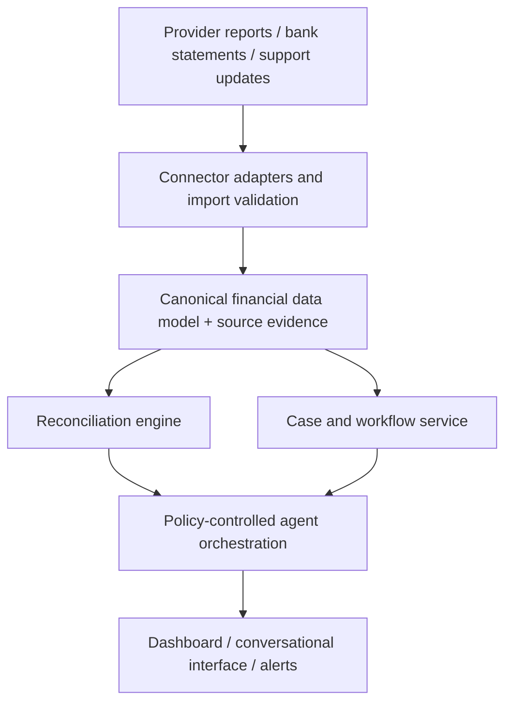
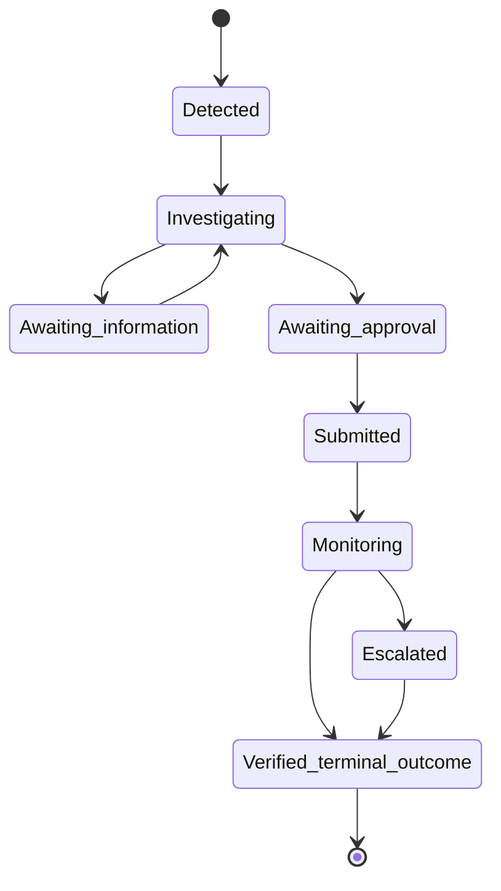

# Architecture Overview

## Design approach

SettleSaathi separates financial truth, workflow control, and language-model assistance. This prevents conversational output from becoming an unverified financial decision.

## Components

| Component | Responsibilities | Must not do |
| --- | --- | --- |
| Connector adapter | Authenticate where authorized, fetch/parse data, validate input, preserve source references | Embed business reconciliation rules. |
| Ingestion service | Deduplicate, version, validate, and persist raw and normalized data | Discard evidence required for audit. |
| Canonical data model | Represent transactions, settlements, adjustments, bank entries, cases, and audit events consistently | Hide provider-specific source identifiers. |
| Reconciliation engine | Calculate amounts and deterministic matching/exceptions | Delegate financial truth to an LLM. |
| Case workflow service | Manage lifecycle, deadlines, approvals, retries, and escalation | Close a case without verification. |
| Policy engine | Decide which actions are allowed, blocked, or approval-gated | Perform an action itself. |
| AI orchestration | Interpret requests, retrieve scoped facts, compose explanations, choose an allowed next tool | Bypass policy or invent source status. |
| UI/API | Present facts, evidence, and human controls | Misrepresent a planned connector as live. |

## Canonical financial model

The implementation should begin with these entities:

| Entity | Required identifiers and facts |
| --- | --- |
| `Transaction` | provider, provider transaction ID, amount, currency, status, occurred time, source reference |
| `SettlementBatch` | provider, settlement ID, expected date, reported status, gross/net amount, payout reference |
| `SettlementLineItem` | settlement ID, transaction/refund/adjustment reference, amount, type |
| `BankEntry` | account, statement entry ID, date, amount, direction, narration, UTR/reference |
| `ReconciliationResult` | input record IDs, rule version, result status, reason, evidence links |
| `Case` | case type, status, owner, related entities, decision summary, required approval |
| `CaseEvent` | timestamp, actor, event type, payload hash/reference, preceding and new status |
| `ConnectorRun` | connector, import/sync ID, source metadata, state, error details |

Amounts use fixed-precision decimal values and an explicit currency. Timestamps retain source timezone or normalized timezone metadata.

## Reconciliation stages

1. Validate and normalize input.
2. Deduplicate by connector/source identity.
3. Match transaction records to settlement line items.
4. Reconcile settlement gross, fee, tax, adjustment, and net values.
5. Match settlement payout references to bank credits.
6. Assign an explainable status and retain rule inputs.
7. Trigger or update a case only when workflow rules require it.

## Agent tool boundary

The agent may call read tools such as `get_case`, `get_reconciliation_evidence`, and `search_connected_records`. It may call a write tool only after the policy engine validates the actor, action, data scope, and any required approval token.

Suggested action classes:

| Action class | Example | Control |
| --- | --- | --- |
| Read | Retrieve settlement evidence | Scoped authorization. |
| Draft | Prepare a support-case payload | Record audit event; user review. |
| External non-sensitive write | Submit a simulated case | Explicit approval when policy requires it. |
| Sensitive / irreversible | Change bank details or move money | Out of scope; always blocked in MVP. |

## Case state model

No transition to a closed state may be based solely on an AI-generated message.
