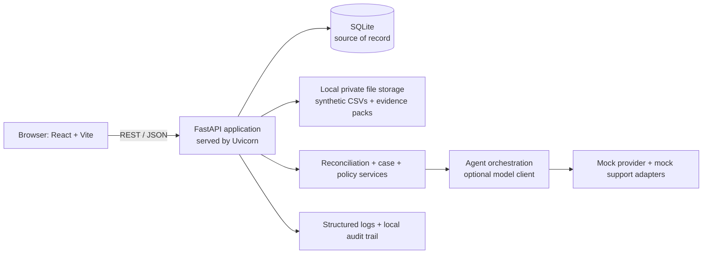
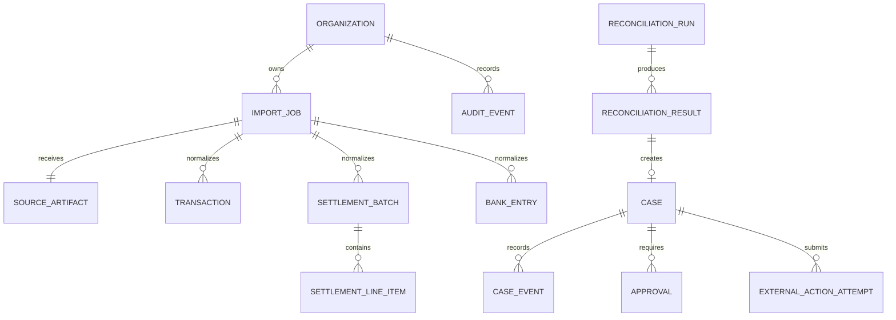
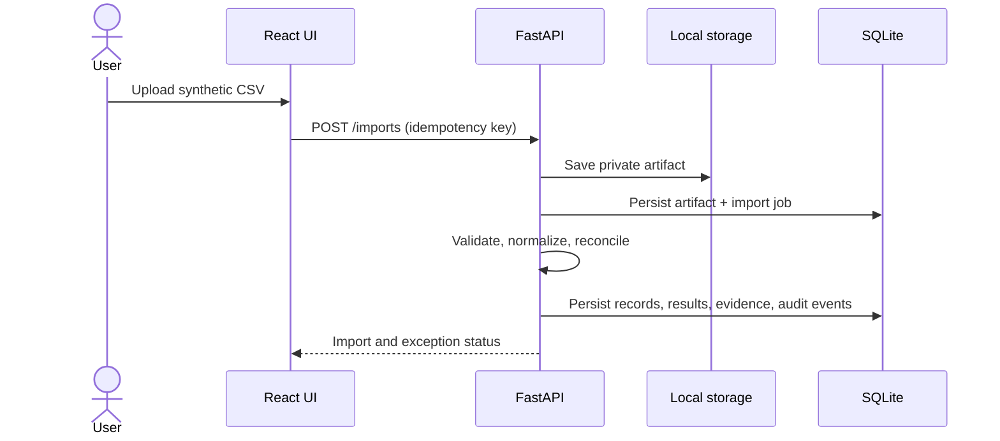
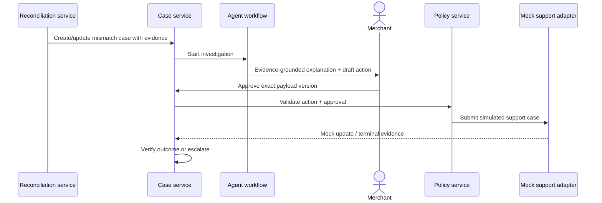
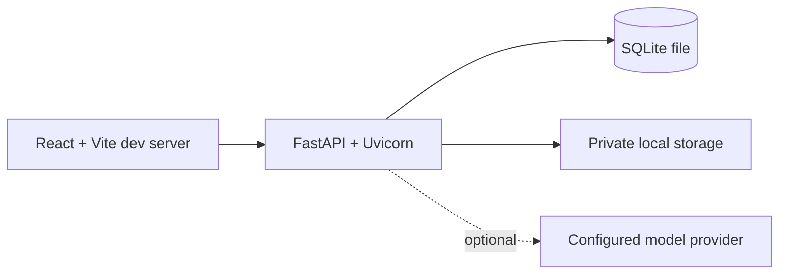

# High-Level Design — SettleSaathi Release 0

**Status:** Proposed architecture for the hackathon prototype  
**Product source of truth:** [Master PRD](../SettleSaathi_PRD_v1.0.md)  
**Delivery scope:** One synthetic, end-to-end settlement-to-bank discrepancy workflow

## 1. Architecture objective

Release 0 must demonstrate a merchant concern moving safely through:

```text
Imported source files -> canonical records -> deterministic reconciliation
-> evidence-backed investigation -> approval-gated mock submission
-> monitored case -> verified terminal outcome
```

The system must make a clear distinction between three values:

1. **Collected amount** — successful customer payment transactions.
2. **Provider-reported settlement** — a payment provider's payout/settlement record.
3. **Bank-confirmed credit** — an imported bank statement credit matched to that payout.

No component may collapse these values into a single “settled” figure.

## 2. Requirements

### 2.1 Data requirements

| Data domain | Required data | Release 0 source | Required properties |
| --- | --- | --- | --- |
| Organization and identity | organization, user, role, store/location | Seeded local data; OIDC-compatible identity when enabled | Tenant-scoped and role-scoped access. |
| Provider transactions | provider transaction ID, timestamp, amount, status, payment method | Synthetic CSV | Immutable source reference, currency, ingestion timestamp. |
| Settlement batches | settlement ID, expected date, gross/net values, payout reference, provider status | Synthetic CSV | Separate gross, fee/tax/adjustment, and net values. |
| Settlement line items | transaction/refund/adjustment reference and amount | Synthetic CSV | Must link to source transaction or adjustment. |
| Bank entries | account, statement entry ID, credit/debit, amount, date, narration, UTR/reference | Synthetic CSV | Statement-period context and source provenance. |
| Reconciliation output | result, reason code, rule version, evidence links | Generated | Fully reproducible from input records. |
| Cases and approvals | lifecycle, decision summary, requested action, approver, payload version | Application data | No restricted action without a valid approval record. |
| Audit events | actor, action, timestamp, correlation ID, related entities, result | Application data | Append-only event history. |

### 2.2 System requirements

- A browser application for data import, dashboard metrics, exception evidence, case timeline, approval, and synthetic-demo reset.
- A typed FastAPI backend that owns validation, authorization, financial rules, case transitions, and audit writing.
- A relational system of record for normalized financial data and workflows.
- Private object storage for source-file artifacts and generated evidence packages.
- An in-process task boundary for imports, reconciliation, case monitoring, and agent workflow steps.
- An optional LLM orchestration layer that can only call typed, policy-checked tools.
- Structured logging, optional traces/metrics, and correlation IDs across request and in-process task paths.
- Deterministic operation without an LLM/API key.

### 2.3 API requirements

- JSON REST API under `/api/v1` with OpenAPI generated by the backend.
- Clerk/OIDC JWT verification when auth is enabled; local demo authentication only behind a development-only flag.
- Organization context derived from validated identity, never trusted solely from a request body.
- Strict schemas, pagination, stable sorting, and an error envelope with `correlation_id`.
- Idempotency keys on imports and simulated external submissions.
- Optimistic concurrency/version checks for approvals and case state transitions.
- No direct public endpoint that can move money, change payout details, or create a live provider-side ticket.

## 3. Recommended Release 0 architecture

This is a self-contained prototype, not a production deployment. Use **SQLite**, local private artifact storage, and FastAPI in one local process. Uvicorn serves the API; `uv` manages Python dependencies and creates the project-local `.venv`. Import and reconciliation work runs in an application-service boundary (synchronously for the small demo files, or through FastAPI background tasks); Redis, Celery, and a separate worker are not Release 0 dependencies.



### 3.1 Component responsibilities

| Component | Responsibilities | Explicitly not responsible for |
| --- | --- | --- |
| Web client | Present data, collect user input, show approvals and evidence | Money calculations, authorization decisions, agent policy enforcement. |
| FastAPI application | API validation, tenant authorization, service orchestration, transactions, audit capture | Direct UI concerns or provider-specific parsing in route handlers. |
| Import adapter | Parse a specific source format; validate and normalize it | Financial matching/business case decisions. |
| Reconciliation service | Exact arithmetic, deterministic matching, exception classification, evidence generation | Natural-language conclusions. |
| Case service | Lifecycle, deadlines, approvals, escalation, state transitions | Reading raw provider files directly. |
| Policy service | Decide allowed, approval-required, or blocked action | Actually calling the external action. |
| Agent workflow | Retrieve scoped evidence, compose explanation, recommend/draft permitted next step | Bypassing policy or asserting payment facts. |
| Application task runner | Run small import, reconciliation, and monitoring tasks synchronously or through FastAPI background tasks | Holding the authoritative workflow state in memory only. |
| Mock adapters | Demonstrate provider/support integration contracts | Claiming live integration. |

## 4. Data architecture

### 4.1 System-of-record choice

Use **SQLite** as the Release 0 system of record. Enable foreign keys and write-ahead logging, use transaction boundaries for each service operation, and keep all database access behind repository interfaces so PostgreSQL can be introduced only if a future deployment requires it.

Store original synthetic CSVs and generated evidence packages in a private local `storage/` directory. Store the relative object path, SHA-256 hash, size, media type, and access scope in SQLite. Do not store large raw documents as database blobs. This storage adapter must be replaceable with S3-compatible storage later.

No Redis, Celery, RabbitMQ, or external job queue is required. Release 0 uses short-lived in-process tasks and persists the task/import state in SQLite before and after work so an interrupted task is visible and can be safely retried.

### 4.2 Initial logical schema



### 4.3 Core entities and non-negotiable fields

| Entity | Required fields |
| --- | --- |
| `source_artifact` | `id`, `organization_id`, `storage_key`, `sha256`, `source_type`, `schema_version`, `ingested_at` |
| `import_job` | `id`, `organization_id`, `artifact_id`, `idempotency_key`, `status`, `record_counts`, `error_summary` |
| `transaction` | `provider`, `provider_transaction_id`, `amount`, `currency`, `status`, `occurred_at`, `source_artifact_id` |
| `settlement_batch` | `provider`, `provider_settlement_id`, `payout_reference`, `gross_amount`, `fee_amount`, `tax_amount`, `adjustment_amount`, `net_amount`, `reported_status` |
| `settlement_line_item` | `settlement_batch_id`, `source_reference`, `line_type`, `amount`, `currency` |
| `bank_entry` | `bank_account_id`, `statement_entry_id`, `booking_date`, `direction`, `amount`, `currency`, `narration`, `utr_reference` |
| `reconciliation_result` | `run_id`, `status`, `reason_code`, `rule_version`, `amount`, `evidence_json`, `evaluated_at` |
| `case` | `organization_id`, `case_type`, `status`, `priority`, `subject_type`, `subject_id`, `decision_summary`, `version` |
| `approval` | `case_id`, `action_type`, `payload_hash`, `approved_by`, `approved_at`, `expires_at`, `status` |
| `audit_event` | `organization_id`, `actor_type`, `actor_id`, `event_type`, `correlation_id`, `entity_type`, `entity_id`, `payload_hash`, `created_at` |

### 4.4 Data integrity and lifecycle rules

- Use `Decimal` or integer minor units; never IEEE 754 floats for monetary values.
- Preserve original provider and statement identifiers, raw-field mapping, time zone/source timestamp, and artifact hash.
- Deduplicate by organization, connector/source identity, and source record ID; use content hash when an ID is unavailable.
- Keep raw artifacts private; extracted/normalized data inherits tenant and least-privilege access rules.
- Version reconciliation rules and policy decisions to make prior results explainable.
- Maintain case/audit history as append-only records. Correct through new events, never silent mutation.

## 5. Processing flows

### 5.1 Import and reconciliation flow



### 5.2 Missing-settlement investigation flow



## 6. API design

### 6.1 Endpoint groups

| Domain | Initial endpoints | Notes |
| --- | --- | --- |
| Health | `GET /health`, `GET /ready` | No sensitive diagnostics exposed publicly. |
| Identity | `GET /me` | Identity is verified from bearer token. |
| Imports | `POST /imports`, `GET /imports/{id}`, `GET /imports/{id}/errors` | Multipart upload; idempotency required. |
| Transactions | `GET /transactions` | Filtered/paginated; read only in Release 0. |
| Settlements | `GET /settlements`, `GET /settlements/{id}` | Shows line-item evidence. |
| Bank records | `GET /bank-entries` | Restricted financial data. |
| Reconciliation | `POST /reconciliation/runs`, `GET /reconciliation/results`, `GET /reconciliation/results/{id}` | The run command queues work; results expose evidence. |
| Cases | `GET /cases`, `POST /cases`, `GET /cases/{id}`, `GET /cases/{id}/timeline` | Case creation may be automatic or explicit. |
| Approvals | `POST /cases/{id}/approvals`, `POST /cases/{id}/approvals/{approvalId}/approve` | Exact action payload/version required. |
| Actions | `POST /cases/{id}/actions/submit-support-case` | Mock-only; checks policy and approval server-side. |
| Agent | `POST /cases/{id}/investigate`, `GET /agent/runs/{id}` | Async, evidence-grounded workflow. |
| Audit | `GET /audit-events` | Admin/auditor access only. |

### 6.2 Request/response conventions

**Headers**

```text
Authorization: Bearer <JWT>
Idempotency-Key: <UUID>                  # required on consequential writes
X-Correlation-ID: <optional client UUID> # generated by server if absent
```

**Error shape**

```json
{
  "error": {
    "code": "APPROVAL_REQUIRED",
    "message": "The requested action requires approval.",
    "details": [{"field": "approval_id", "reason": "missing"}],
    "correlation_id": "..."
  }
}
```

**Action rule:** an agent-generated payload is a draft. The action endpoint validates the current policy, case state, payload hash, approval status, and idempotency key independently of any model output.

### 6.3 Event contracts

Start with application events persisted in the database and handled by the in-process task boundary:

```text
import.completed
reconciliation.completed
reconciliation.exception_detected
case.created
case.status_changed
approval.granted
support_case.submission_requested
support_case.submitted
case.verification_required
case.verified_closed
case.escalated
```

Every event must include an event ID, organization ID, occurred timestamp, correlation ID, schema version, actor, and related entity IDs.

## 7. Security and operational design

### 7.1 Authentication and authorization

- Release 0 uses seeded demo users and roles stored in SQLite; the active demo identity is selected locally, not accepted from an arbitrary tenant field in the browser.
- Bind every request to the selected demo user's organization and role; retain server-side scope checks in the same place a future JWT middleware will call them.
- Initial roles: merchant viewer, finance operator, operations manager, organization admin, auditor.
- Clerk/OIDC is a future adapter only; it is not required to run the hackathon prototype.

### 7.2 Secrets and environment configuration

The environment dump contains credentials/configuration values. It must be treated as secret material: **do not commit it, print it in logs, or copy values into documentation.** Add it to local ignore rules and create a redacted `.env.example` containing only variable names and safe defaults.

The initial configuration groups are:

| Group | Use in Release 0 |
| --- | --- |
| SQLite configuration | Local relational persistence in a project-private data directory. |
| Local storage configuration | Private raw-file and evidence storage under `storage/`. |
| Clerk fields | Not used in Release 0; retain only for a future authentication adapter. |
| LiteLLM/OpenRouter/Azure/Bedrock/Ollama fields | Choose one provider behind one model client; never call several by default. |
| OTEL/Langfuse fields | Observability, redacted traces, and agent evaluation. |
| Qdrant fields | Deferred unless policy/support retrieval proves necessary. |

### 7.3 Observability

- Generate a correlation ID at ingress and propagate it to background tasks and audit events.
- Record structured logs without credentials or unredacted raw financial documents.
- Capture metrics for import failures, duplicate imports, reconciliation counts, exceptions, approval denials, agent tool errors, and false-closure test results.
- Trace API and background-task spans using OpenTelemetry only if it can be configured locally without blocking the prototype. Send LLM observability only after data-redaction review.

## 8. Deployment view

For the prototype, run only the frontend development server and the FastAPI application:



The system is a modular monolith in one repository. `uv venv .venv` creates the project-local virtual environment, and `uv run uvicorn ...` runs the backend inside it. Add containers, queues, and external services only when the prototype proves a concrete need.

## 9. Explicit non-goals and architecture gates

- No live Paytm, bank, or other payment-provider integration without documented authorization and contract validation.
- No web scraping of provider dashboards.
- No payment initiation, refund issuance, bank-detail modification, OTP/PIN/CVV handling, or money movement.
- No LLM authority for financial status, calculation, authorization, or case closure.
- No Qdrant/RAG requirement for Release 0; add only for a validated policy/document retrieval use case.

## 10. Architecture acceptance criteria

- [ ] A source file can be imported without exposing its contents to other organizations.
- [ ] Re-running an identical import produces a safe idempotent outcome.
- [ ] A reconciliation result has source evidence and rule version.
- [ ] The dashboard separately displays collections, provider settlements, and bank credits.
- [ ] The support submission endpoint rejects missing/stale approval and duplicate requests.
- [ ] A case cannot be verified closed without qualifying terminal evidence.
- [ ] Logs/traces/audit events share correlation IDs and omit secrets.
- [ ] The synthetic ₹18,450 discrepancy scenario can be demonstrated end-to-end.
