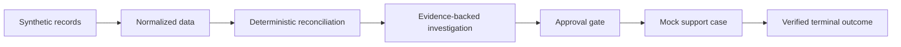

# Implementation Plan

**Product baseline:** [SettleSaathi PRD v1.0](../../SettleSaathi_PRD_v1.0.md)  
**Delivery target:** Release 0 — hackathon prototype  
**Planning rule:** No live provider, bank, or support action is in scope until an approved contract and credentials exist.

## Delivery strategy

Build a self-contained modular monolith that demonstrates one complete, safe workflow before adding breadth:

The UI, API, workflow engine, and persistence layer must support this exact flow. Optional AI assistance improves interaction and explanation; it is not a dependency for financial correctness.

## Milestones

| ID | Milestone | Outcome | Exit gate |
| --- | --- | --- | --- |
| M0 | Foundation | Repository, local environment, conventions, and CI checks exist. | A clean clone runs linting and tests with documented commands. |
| M1 | Domain model and data ingestion | Synthetic provider and bank files load into canonical records with provenance and idempotency. | Repeat import does not create duplicate financial records. |
| M2 | Deterministic reconciliation | Transaction-to-settlement and settlement-to-bank reconciliation yields explainable results. | Core matching and exception tests pass, including partial and unmatched cases. |
| M3 | Cases, audit, and policy | Exceptions become persistent cases; restricted actions require a valid approval. | Submission is blocked without approval and every transition is audited. |
| M4 | API and dashboard | A reviewer can view core metrics, evidence, exceptions, and case timeline. | UI/API display collections, settlement, and bank credit as distinct values. |
| M5 | Agent orchestration | The agent can retrieve evidence, explain results, and propose or draft an allowed workflow. | Generated output is grounded in stored evidence; no direct privileged action is possible. |
| M6 | Mock support and verification | A simulated external case is submitted after approval and moves to a verified outcome. | The full demo scenario runs end-to-end; false closure is prevented. |
| M7 | Demo hardening | Tests, seed data, documentation, and demo script are reliable. | A new reviewer can run the scenario unaided. |

## Work breakdown

### M0 — Foundation

1. Create the modular-monolith repository structure, `pyproject.toml`, and React/Vite workspace.
2. Create the project-local `.venv` with `uv`; add local setup, environment template, formatter/linter, and test runner.
3. Define error, logging, correlation-ID, and configuration conventions.
4. Create a FastAPI app served by Uvicorn, a minimal frontend shell, and health endpoint.

**Dependencies:** none.  
**Deliverables:** runnable local project using SQLite and local private storage, CI baseline, `.env.example`, engineering onboarding notes.

### M1 — Domain model and ingestion

1. Define entities for transaction, settlement batch, settlement line item, bank entry, import job, and source provenance.
2. Create versioned synthetic CSV fixtures matching the demo scenario.
3. Implement parsing, validation, normalization, idempotency, and import-result reporting.
4. Preserve raw source metadata and source record identifiers.

**Dependencies:** M0.  
**Deliverables:** import API/service, fixtures, validation errors, duplicate-import tests.

### M2 — Deterministic reconciliation

1. Implement exact decimal/money utilities.
2. Match transactions to settlement line items by source reference and defined fallback rules.
3. Match settlement payouts to bank entries using payout/UTR reference, amount, direction, and date window.
4. Implement statuses and reason codes: reconciled, within expected window, delayed, partial, unmatched, duplicate, adjustment-explained.
5. Store rule version, evidence IDs, and explanation fields in every result.

**Dependencies:** M1.  
**Deliverables:** reconciliation run service, result API, fixture-based rule tests.

### M3 — Case workflow, policy, and audit

1. Implement the case state machine: `Detected`, `Investigating`, `Awaiting information`, `Awaiting approval`, `Submitted`, `Monitoring`, `Escalated`, and verified terminal states.
2. Define action classes and policy decisions: allowed, approval-required, blocked.
3. Implement approval token/record validation and idempotent action execution.
4. Write append-only audit events for imports, rules, case transitions, approvals, and action attempts.

**Dependencies:** M2.  
**Deliverables:** case API/service, policy service, audit viewer data, workflow tests.

### M4 — API and dashboard

1. Expose read APIs for dashboard metrics, exceptions, evidence, cases, and audit history.
2. Build the smallest UI necessary for the demo: import, dashboard, exception detail, case timeline, and approval dialog.
3. Ensure collections, provider settlement, and bank credit are never collapsed into one figure.
4. Present synthetic-data status visibly.

**Dependencies:** M1–M3.  
**Deliverables:** reviewable end-to-end UI with error and empty states.

### M5 — Agent orchestration

1. Define typed, narrow read tools for case and reconciliation evidence.
2. Define a policy-checked draft/submit tool boundary.
3. Implement an orchestration state machine that retrieves facts, creates a human-readable explanation, recommends next steps, and requests approval when required.
4. Add a deterministic fallback explanation for operation without a model key.
5. Add groundedness, unsafe-action, and false-closure evaluation cases.

**Dependencies:** M2–M4.  
**Deliverables:** agent workflow, prompt/tool contracts, evaluation fixtures, visible evidence citations in the UI.

### M6 — Mock support and verification

1. Implement a mock support connector with controlled responses.
2. Submit only after a policy-valid approval.
3. Poll or ingest a simulated update.
4. Verify a terminal outcome by new authoritative mock evidence; otherwise keep the case active or escalate.

**Dependencies:** M3–M5.  
**Deliverables:** simulated case submission, monitoring, verified-resolution and escalation paths.

### M7 — Demo hardening

1. Add a one-command seed/reset flow that is non-destructive to user data.
2. Execute the complete acceptance scenario from the PRD.
3. Add regression tests for money arithmetic, idempotency, authorization, audit completeness, and false closure.
4. Produce setup, demo, and troubleshooting guides.

**Dependencies:** M0–M6.  
**Deliverables:** reliable demo package and completed tracker evidence.

## Critical dependencies and gates

| Dependency | Rule |
| --- | --- |
| Provider APIs, webhooks, or reports | Implement only after an authorized, verified data contract; keep an adapter boundary. |
| Bank data | Use synthetic or user-supplied CSV fixtures in Release 0; do not fabricate bank integration. |
| LLM provider | Optional; implement deterministic fallback and do not expose secrets in client or logs. |
| External support action | Mock-only in Release 0; enforce explicit approval even for the mock. |
| Production deployment | Deferred; no production claim without security, privacy, operational, and contract review. |

## Release 0 completion checklist

- [ ] Synthetic data is visibly labeled.
- [ ] Imports are validated, traceable, and idempotent.
- [ ] Money uses decimal or minor-unit precision.
- [ ] Reconciliation decisions expose rule version and source evidence.
- [ ] Provider settlement and bank credit remain distinct.
- [ ] Restricted actions cannot bypass approval.
- [ ] All case transitions and external action attempts are audited.
- [ ] Closure requires verification, not agent narration.
- [ ] Automated tests and the full demo scenario pass.
