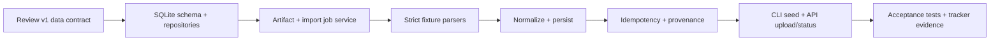

# M1 Plan — Domain Model and Data Ingestion

**Goal:** Load the delivered synthetic v1 bundle into SQLite through a repeatable import pipeline, preserve provenance, and expose validated records for the reconciliation phase.

**Contract:** [Data strategy](../DATA_STRATEGY.md), [data dictionary](../../serv_data/contracts/data_dictionary.md), [fixture schema](../../serv_data/contracts/schema_specs.md), and [v1 handoff](../../serv_data/fixtures/v1/HANDOFF.md).

## Phase sequence

### M1.0 — Contract review

- Compare schema contract, handoff, generated files, and actual headers/record links.
- Record any accepted ambiguity before encoding schema or parser assumptions.
- Preserve separate statuses for transaction, provider settlement, and bank credit.

### M1.1 — Domain model and SQLite schema

- Add SQLite connection/configuration using the existing `SETTLESAATHI_DATABASE_URL`.
- Enable foreign keys and WAL mode; create the database directory safely.
- Add tables for organizations, stores, bank accounts, source artifacts, import jobs, transactions, settlement batches, settlement line items, bank entries, and audit events/provenance.
- Use exact fixed-precision money representation (canonical decimal strings or integer minor units); document the choice.
- Add unique constraints for source IDs within their provider/tenant scope and indexes for import/source lookups.
- Keep persistence behind repository/service boundaries; do not introduce an ORM unless it reduces total MVP complexity.

### M1.2 — Artifact and import-job lifecycle

- Compute a SHA-256 digest and record source type, file name, schema/dataset version, size, and origin.
- Store only app-managed synthetic fixture copies/uploads beneath the configured private storage root.
- Create a persisted import job before parsing, with states `PENDING`, `PROCESSING`, `COMPLETED`, `FAILED`.
- Record row counts and structured row-level errors without echoing sensitive file content.

### M1.3 — Strict parsers and validation

- Parse the exact v1 CSV headers and JSON update schema from the data contract.
- Validate manifest version, required columns, non-empty identifiers, safe mock prefixes, allowed enums, UTC/date formats, INR currency, and two-decimal amounts.
- Validate settlement balance invariant and all known foreign-key-like references.
- Keep malformed/negative fixtures isolated from the valid demo import.
- Reject unsupported schema versions explicitly; do not guess or silently coerce malformed money/date fields.

### M1.4 — Normalization and persistence

- Map source rows to canonical models while retaining source artifact ID, row number, original source ID, and source timestamp.
- Persist normalized records in an atomic transaction per import; a failed import must not leave a partially visible dataset.
- Persist all imported record classes needed by later reconciliation.
- Record import and completion/failure audit events.

### M1.5 — Idempotency and safe re-import

- Define idempotency using organization + source type + schema version + artifact digest.
- Re-importing an identical artifact returns the existing import result without duplicating records.
- A changed artifact with conflicting source identifiers fails with explicit conflict details; no silent overwrite.
- Expose a separately explicit demo reset/replace operation later; normal import never deletes existing records.

### M1.6 — Developer and API entry points

- Add a deterministic local seed command that imports `serv_data/fixtures/v1` through the same service used by uploads.
- Add API endpoints for multipart CSV/manifest upload, import job status, and row errors.
- Keep processing synchronous or use FastAPI background tasks while saving job state before and after processing.
- Update the web shell with a synthetic data load/import action and visible origin/version labels.

## Acceptance gates

1. Fresh SQLite database is initialized with documented schema and FK enforcement.
2. Valid v1 bundle imports all records and retains artifact/hash/row provenance.
3. Re-import of each identical artifact is a safe idempotent no-op.
4. Invalid fixtures produce actionable row/field errors and no partial records.
5. Every amount remains exact and settlement balance validation matches the fixture oracle.
6. Data origin and dataset version remain queryable for every imported record.
7. Unit/API tests cover valid import, malformed fields, referential errors, transaction rollback, and repeated import.
8. Seed/import can run offline from repository files with no external API key.

## Out of scope for M1

Reconciliation algorithms beyond import validation, cases/agent workflows, live API integrations, PDF parsing, authentication-provider integration, and provider-wide generalization beyond the v1 adapter contract.
