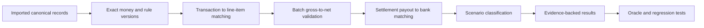

# M2 Plan — Deterministic Reconciliation

**Goal:** Reconcile imported transaction, settlement, line-item, and bank-entry records using exact financial arithmetic and explainable deterministic rules.

**Inputs:** Completed [M1 import layer](M1_PLAN.md), the validated fixture bundle, and its [expected-results oracle](../../serv_data/fixtures/v1/expected_results.json).

## Phase sequence

### M2.0 — Contract and fixture mapping

- Map scenario IDs to imported source record IDs using the oracle.
- Confirm meanings for adjustment signs, refunds, duplicate handling, many-to-one matches, and expected settlement windows.
- Record any ambiguity before finalizing classification rules.

### M2.1 — Money primitives and rule versioning

- Use the canonical Decimal parsing/formatting helpers from M1.
- Define explicit comparison tolerances (zero by default for synthetic fixtures).
- Store a reconciliation ruleset version and evaluation timestamp with every run/result.

### M2.2 — Transaction to settlement matching

- Match settlement line items to transactions by provider transaction ID.
- Handle duplicate source rows according to M1 deduplication outcomes.
- Surface missing or conflicting references as `REQUIRES_REVIEW`; do not discard them.
- Calculate collected versus provider-reported settlement values separately.

### M2.3 — Settlement batch accounting

- Verify gross, fee, tax, signed adjustment, and net invariants.
- Classify expected deductions as `ADJUSTMENT_EXPLAINED` only when source lines and batch values support the calculation.
- Preserve partial settlement residuals.

### M2.4 — Settlement payout to bank matching

- Match by UTR/payout reference first, then apply documented amount/date fallback rules.
- Support one-to-one, many-to-one, and one-to-many candidate groups where evidence is unambiguous.
- Never infer credit from provider status alone.
- Consider imported statement coverage and fixed as-of time before classifying an absent credit as delayed/unmatched.

### M2.5 — Status and evidence generation

- Implement statuses: `RECONCILED`, `WITHIN_EXPECTED_WINDOW`, `DELAYED`, `PARTIALLY_MATCHED`, `UNMATCHED`, `DUPLICATE`, `ADJUSTMENT_EXPLAINED`, and `REQUIRES_REVIEW`.
- Emit reason codes, matched/unmatched amounts, contributing record IDs, statement coverage, rule version, and concise deterministic explanation.
- Persist run/results and source links to SQLite.

### M2.6 — Oracle, API, and UI

- Compare all scenario results against `expected_results.json`.
- Add an API for starting a reconciliation run and reading run/results/evidence.
- Show separate collection, provider settlement, and bank-confirmed metrics in UI.
- Allow scenario filters and exception detail views.

## Acceptance gates

1. All SCN-01 through SCN-10 expected statuses and amounts match the oracle.
2. Exact money arithmetic and settlement invariants pass.
3. Duplicate rows do not inflate totals.
4. Provider-reported payout without bank evidence is never described as bank-confirmed.
5. SCN-03 remains within its expected window and does not create an unnecessary case.
6. Partial, adjustment, refund, and many-to-one cases have traceable contributing records.
7. Every result is reproducible from persisted inputs and rule version.
8. API and UI display evidence and uncertainty without an LLM dependency.

## Out of scope

Agent narration, case approval/submission workflow, live connectors, fuzzy machine-learning matching, and automatic tolerance learning.
