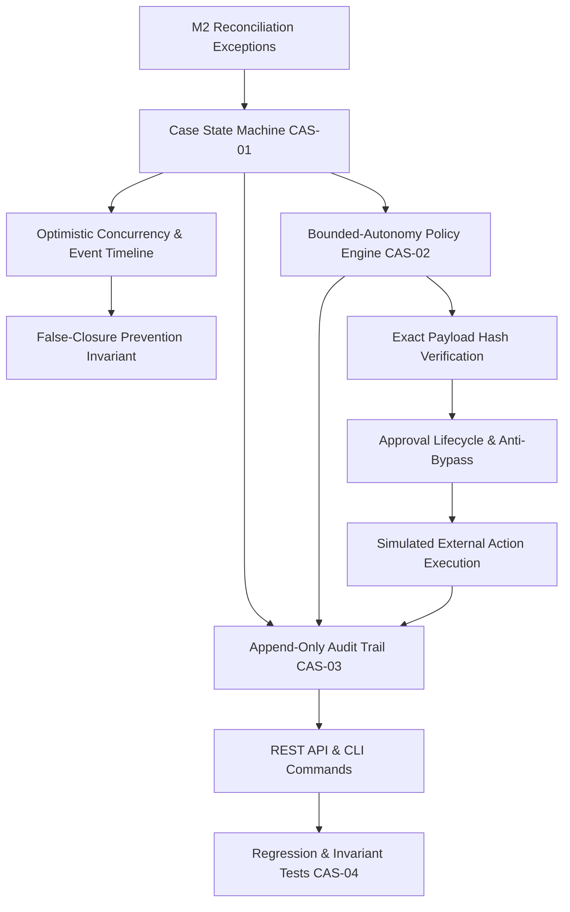

# M3 Plan — Cases, Policy, and Audit

**Goal:** Implement the case management state machine, event timeline, bounded-autonomy policy engine, exact-payload approval verification, and append-only audit trail for SettleSaathi.

**Inputs:** Completed [M1 ingestion layer](M1_PLAN.md), [M2 deterministic reconciliation](M2_PLAN.md) (notably SCN-02 hero missing settlement exception), [HLD](../HLD.md), [Security & Governance](../SECURITY_GOVERNANCE.md), and [Agentic Architecture](../AGENTIC_ARCHITECTURE.md).

## Phase sequence

### M3.1 — Schema & Domain Entity Models (CAS-01, CAS-02, CAS-03)
- Extend `app/db/schema.sql` with tables:
  - `cases`: case identification, tenant scope, reconciliation linkage, status, priority, subject, decision summary, and integer `version` for optimistic concurrency.
  - `case_events`: chronological event timeline tracking actor type (`USER`, `AGENT`, `SYSTEM`), actor ID, state transitions (`from_status` -> `to_status`), summary, and structured metadata.
  - `approvals`: action type, action class, canonical payload SHA-256 digest, raw payload, status (`PENDING`, `APPROVED`, `REJECTED`, `EXPIRED`, `EXECUTED`), requester, approver, and expiration window.
  - `external_action_attempts`: idempotent execution tracking with tenant-scoped idempotency key, approval linkage, payload hash, execution status, and simulated provider reference.
  - `audit_events`: upgrade audit schema to record `actor_type`, `actor_id`, `correlation_id`, `entity_type`, `entity_id`, `event_type`, `payload_hash`, `details_json`, and `created_at`.
- Add dataclasses, value objects, and enum constants in `app/models/domain.py`.

### M3.2 — Case State Machine & Concurrency Control (CAS-01)
- Codify explicit state transitions:
  - `DETECTED` -> `INVESTIGATING` | `ESCALATED`
  - `INVESTIGATING` -> `AWAITING_INFORMATION` | `AWAITING_APPROVAL` | `MONITORING` | `ESCALATED`
  - `AWAITING_INFORMATION` -> `INVESTIGATING` | `ESCALATED`
  - `AWAITING_APPROVAL` -> `SUBMITTED` | `INVESTIGATING` | `ESCALATED`
  - `SUBMITTED` -> `MONITORING` | `ESCALATED`
  - `MONITORING` -> `VERIFIED_RESOLVED` (requires authoritative evidence) | `ESCALATED` | `INVESTIGATING`
  - `VERIFIED_RESOLVED` -> Terminal verified state
  - `ESCALATED` -> `INVESTIGATING` | `VERIFIED_RESOLVED` (with evidence)
- Implement optimistic locking via `version` column in `cases`. If the expected version does not match the stored version, abort with `VersionMismatchError` (HTTP 409).
- Append every status transition and case update into `case_events`.

### M3.3 — False-Closure Prevention Invariant (CAS-01, CAS-04)
- Enforce the foundational safety rule: a case **cannot** transition to `VERIFIED_RESOLVED` based on model or user narration alone.
- Transition to `VERIFIED_RESOLVED` requires verified authoritative terminal evidence:
  - An authoritative support resolution record (`mock_support_updates`) with `terminal_outcome = true`, OR
  - An authoritative bank credit matching payout amount / UTR, OR
  - A deterministic reconciliation result in status `VERIFIED_RESOLVED`.
- Attempts to close without authoritative evidence fail immediately with `FalseClosureError`.

### M3.4 — Bounded-Autonomy Policy Engine (CAS-02)
- Categorize operations into action classes:
  - `READ`: unconditionally `ALLOWED`.
  - `DRAFT`: unconditionally `ALLOWED`.
  - `EXTERNAL_NON_SENSITIVE_WRITE`: `ALLOWED` (configurable).
  - `SENSITIVE_WRITE`: `APPROVAL_REQUIRED` (e.g., submitting external support cases or dispute requests).
  - `BLOCKED`: strictly `BLOCKED` (e.g., money movement, altering bank/payout configurations, bypass attempts).
- Compute canonical payload hashes (deterministic JSON serialization with sorted keys).
- Prevent approval bypass: actions requiring approval cannot execute without an `APPROVED` unexpired approval record.
- Prevent payload tampering: verify that the runtime payload matches the approved payload hash exactly.
- Prevent agent self-approval: agents and system actors cannot grant approvals; only authorized human roles may approve.

### M3.5 — Append-Only Audit Trail (CAS-03)
- Provide an immutable audit logging service capturing actor, correlation ID, entity type, entity ID, event type, payload hash, and structured details.
- Audit every state transition, policy decision, approval request, approval grant/rejection, and external action attempt.

### M3.6 — REST API & CLI Interface
- Expose REST API endpoints under `/api/v1/cases`:
  - `GET /cases`: list cases with filtering by organization, status, priority, and case type.
  - `POST /cases`: create a case manually or from a reconciliation result.
  - `GET /cases/{id}`: get case details.
  - `POST /cases/{id}/transition`: transition status with version checking and evidence verification.
  - `GET /cases/{id}/timeline`: retrieve chronological case events.
  - `GET /cases/{id}/approvals`: list approvals for a case.
  - `POST /cases/{id}/approvals`: request approval with payload and computed hash.
  - `POST /cases/{id}/approvals/{approval_id}/approve`: approve or reject an approval.
  - `POST /cases/{id}/actions/submit-support-case`: policy-gated, approval-verified action submission.
- Expose CLI commands in `app/cli.py`:
  - `cases`: list cases for an organization.
  - `case-detail`: show case metadata and chronological event timeline.
  - `approve-case`: approve or reject a pending approval.

### M3.7 — Comprehensive Test Suite & Acceptance Gates (CAS-04)
- `tests/test_cases.py`: state machine transitions, optimistic concurrency, and false-closure rejection.
- `tests/test_policy.py`: policy evaluation, hash mismatch detection, expiry, and self-approval prevention.
- `tests/test_api_cases.py`: REST API verification covering case creation, timeline, approval flow, and action execution.
