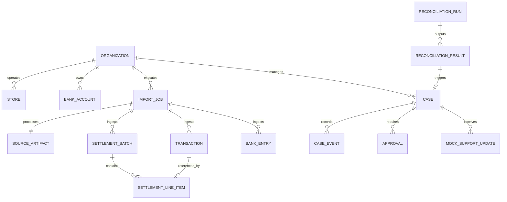

# SettleSaathi Canonical Data Dictionary

**Document Version:** 1.0  
**Status:** Approved Release 0 Contract  
**Dataset Version:** `v1`  
**Currency:** `INR` (Strict two decimal places, e.g., `18450.00`)

This data dictionary defines the canonical financial entities, value representations, field types, constraints, and entity relationships for SettleSaathi.

---

## 1. Entity Relationship Model

---

## 2. Core Entities

### 2.1 `Transaction` (Payment Collection)
Represents a customer payment collected via a payment provider (e.g. UPI, QR, card, net banking).

| Field Name | Type | Constraints | Description |
| :--- | :--- | :--- | :--- |
| `provider` | `string` | Required, enum (`PAYTM_MOCK`) | Originating payment provider. |
| `provider_transaction_id`| `string` | Required, unique, prefixed `mock_txn_` | Provider's unique transaction reference. |
| `merchant_reference` | `string` | Required, prefixed `mock_ord_` | Merchant's internal order or invoice reference. |
| `store_id` | `string` | Required, foreign key to Store | Store identifier (`store_indiranagar`, `store_koramangala`). |
| `occurred_at` | `ISO 8601 UTC` | Required, e.g. `2026-10-29T10:15:30Z` | Timestamp when payment was authorized. |
| `status` | `string` | Required, enum (`SUCCESS`, `FAILED`, `REFUNDED`) | Status of the customer payment. |
| `payment_method` | `string` | Required, enum (`UPI`, `CARD`, `NET_BANKING`) | Instrument used for payment. |
| `gross_amount` | `Decimal(12,2)`| Required, positive, e.g. `500.00` | Amount paid by customer in INR. |
| `currency` | `string` | Required, fixed `INR` | ISO 4217 currency code. |

---

### 2.2 `SettlementBatch` (Provider Settlement Payout)
Represents a payout batch compiled by the payment provider for settlement into the merchant's bank account.

| Field Name | Type | Constraints | Description |
| :--- | :--- | :--- | :--- |
| `provider` | `string` | Required, fixed `PAYTM_MOCK` | Originating payment provider. |
| `provider_settlement_id` | `string` | Required, unique, prefixed `mock_settle_` | Provider's settlement batch identifier. |
| `payout_reference` | `string` | Required, unique, prefixed `mock_utr_` | UTR or provider payout reference. |
| `settlement_date` | `ISO 8601 Date`| Required, e.g. `2026-10-30` | Date provider initiated or reported payout. |
| `reported_status` | `string` | Required, enum (`PROCESSED`, `PENDING`, `FAILED`) | Status reported in provider's portal. |
| `gross_amount` | `Decimal(12,2)`| Required, positive | Sum of all constituent transactions. |
| `fee_amount` | `Decimal(12,2)`| Required, >= 0.00 | MDR / payment processing fee deducted. |
| `tax_amount` | `Decimal(12,2)`| Required, >= 0.00 | GST applied on MDR fees. |
| `adjustment_amount` | `Decimal(12,2)`| Required, signed (+/-) | Adjustments (refunds, chargebacks, dispute holds). |
| `net_amount` | `Decimal(12,2)`| Required, `gross - fee - tax + adjustment` | Net amount transferred by provider. |
| `currency` | `string` | Required, fixed `INR` | ISO 4217 currency code. |

**Balance Invariant:**
$$\text{net\_amount} = \text{gross\_amount} - \text{fee\_amount} - \text{tax\_amount} + \text{adjustment\_amount}$$

---

### 2.3 `SettlementLineItem` (Settlement Composition)
Itemized transaction or deduction contributing to a settlement batch.

| Field Name | Type | Constraints | Description |
| :--- | :--- | :--- | :--- |
| `provider_settlement_id` | `string` | Required, FK to `SettlementBatch` | Owning settlement batch ID. |
| `line_item_id` | `string` | Required, unique, prefixed `mock_line_` | Unique line item reference. |
| `source_reference` | `string` | Required, FK to `Transaction.provider_transaction_id` or adjustment ref | Contributing transaction or adjustment ID. |
| `line_type` | `string` | Required, enum (`PAYMENT`, `REFUND`, `DISPUTE_HOLD`, `ADJUSTMENT`) | Nature of the line entry. |
| `amount` | `Decimal(12,2)`| Required, signed | Line amount contributing to gross or adjustment. |
| `currency` | `string` | Required, fixed `INR` | ISO 4217 currency code. |

---

### 2.4 `BankEntry` (Bank Statement Credit/Debit)
Actual transaction record from the merchant's official bank statement.

| Field Name | Type | Constraints | Description |
| :--- | :--- | :--- | :--- |
| `statement_entry_id` | `string` | Required, unique, prefixed `mock_bank_` | Bank's internal transaction ID. |
| `bank_account_alias` | `string` | Required, fixed `bank_acc_4092` | Bank account reference alias. |
| `booking_date` | `ISO 8601 Date`| Required, e.g. `2026-10-30` | Date credit posted to account. |
| `direction` | `string` | Required, enum (`CREDIT`, `DEBIT`) | Transaction direction. |
| `amount` | `Decimal(12,2)`| Required, positive | Amount credited or debited. |
| `currency` | `string` | Required, fixed `INR` | ISO 4217 currency code. |
| `narration` | `string` | Required, descriptive text | Bank narration line (e.g., `NEFT-PAYTM-MOCK_UTR_001`). |
| `utr_reference` | `string` | Optional, prefixed `mock_utr_` | Bank UTR extracted from narration. |

---

### 2.5 `MockSupportUpdate` (Provider Support Resolution Event)
Simulated case updates returned from the mock provider support connector.

| Field Name | Type | Constraints | Description |
| :--- | :--- | :--- | :--- |
| `case_reference` | `string` | Required, prefixed `mock_case_` | Associated support case identifier. |
| `event_at` | `ISO 8601 UTC` | Required | Timestamp of support event. |
| `status` | `string` | Required, enum (`SUBMITTED`, `IN_REVIEW`, `RESOLVED`, `REJECTED`) | External ticket status. |
| `summary` | `string` | Required | Resolution notes or status summary. |
| `terminal_outcome` | `boolean` | Required (`true` or `false`) | Flag whether ticket outcome is definitive. |
| `evidence_reference` | `string` | Required | Authoritative verification reference. |

---

## 3. ID Conventions & Synthetic Prefixes

To prevent mixing synthetic records with production data, all IDs strictly observe non-routable synthetic prefixes:

| Entity | Prefix | Example |
| :--- | :--- | :--- |
| Transaction | `mock_txn_` | `mock_txn_20261029_001` |
| Settlement Batch | `mock_settle_` | `mock_settle_20261030_001` |
| Settlement Line Item | `mock_line_` | `mock_line_20261030_001` |
| Bank Entry | `mock_bank_` | `mock_bank_20261030_001` |
| Case Reference | `mock_case_` | `mock_case_scn02_001` |
| UTR / Payout Reference | `mock_utr_` | `mock_utr_20261030_001` |
| Order / Merchant Ref | `mock_ord_` | `mock_ord_20261029_001` |

